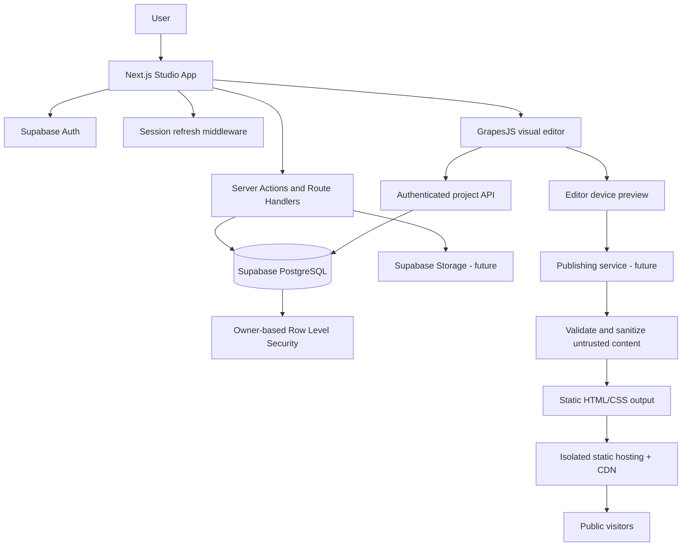

# Asnor Studio Architecture

## Product principle

A visual drag-and-drop website builder. Users create and style websites themselves with templates and editable components. Website generation must not rely on AI.

## System overview

## Current foundation

- Next.js App Router, React, TypeScript, Tailwind CSS.
- Supabase Auth with Google OAuth and email one-time-code sign-in.
- SSR cookie refresh through middleware and server client helpers.
- Session cookie by default; optional 30-day persistent session preference.
- Authenticated dashboard and project creation.
- PostgreSQL `projects` table with owner-based RLS.
- GrapesJS early editor with starter blocks, device previews, and server API autosave.
- Baseline browser security headers.
- CI workflow for lint, TypeScript, and production build.

## Request and authorization rules

1. Resolve the current user on the server using Supabase Auth.
2. Derive `owner_id` from the verified session. Never accept the owner from a client request.
3. Restrict updates by both project ID and authenticated owner.
4. Keep RLS enabled and explicit for the `authenticated` database role.
5. Require `USING` and `WITH CHECK` ownership predicates on project updates.
6. Keep service-role credentials out of browser and `NEXT_PUBLIC_*` environments.
7. Apply input shape and payload-size validation to autosave requests.
8. Treat all user-created site content as untrusted.

## Publishing isolation

The Studio application and public websites must remain separate security origins. Never render saved user HTML as a page on the Studio origin. Before publishing, introduce a validation and sanitization pipeline, reject scripts and unsafe URLs, and serve generated sites on isolated domains or subdomains with appropriate response headers. Publishing infrastructure has not yet been implemented.

## Planned data model

- `projects`: owner, name, timestamps, editor state.
- `pages`: project, slug, metadata, editor state.
- `assets`: owner/project, storage metadata.
- `publications`: version, URL, status, and publish timestamp.
- `project_settings`: design tokens and site-level settings.

## Development phases

1. Foundation: authentication, sessions, project ownership, database security, server APIs, CI.
2. Editor: reliable editing, design controls, templates, multi-page support, responsive preview, autosave/recovery.
3. Publishing: validation, static output, isolated public URLs, versioned republishing.
4. Production: security review, accessibility, performance, monitoring, backup/restore, end-to-end testing.
5. Advanced: custom domains, collaboration, forms, analytics, marketplace.
