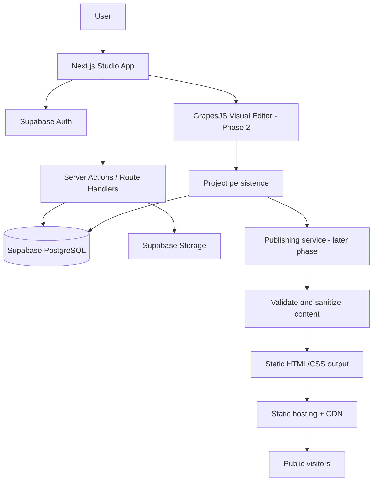

# Asnor Studio Architecture

## Product principle
A visual drag-and-drop website builder. Users create sites with templates and design controls; no AI website generation.

## System overview

## Phase 1
- Next.js App Router, React, TypeScript, Tailwind CSS.
- Supabase Auth with SSR cookie handling.
- PostgreSQL projects table protected by RLS.
- Landing page, signup/signin, dashboard, project creation.
- Public URL + anon/publishable key only; never expose service-role keys.

## Planned data model
- projects: owner, name, timestamps (created in Phase 1)
- pages: project, slug, metadata, editor state
- assets: owner/project, storage metadata
- publications: version, URL, status
- project_settings: design tokens and site settings

## Security
- Authenticate on server-side routes/actions.
- Derive owner identity from authenticated session, never client-supplied IDs.
- RLS is the database access boundary.
- Treat website content as untrusted; published content must not execute on studio origin.
- Upload policies, limits, and MIME/content validation must exist before asset uploads ship.

## Phases
1. Foundation: landing, auth, dashboard, projects, RLS.
2. Editor: GrapesJS, controls, templates, responsive preview, autosave.
3. Publishing: validation, static output, public URLs, republish.
4. Production: tests, accessibility, monitoring, backups, security review.
5. Advanced: custom domains, collaboration, forms, analytics, marketplace.
